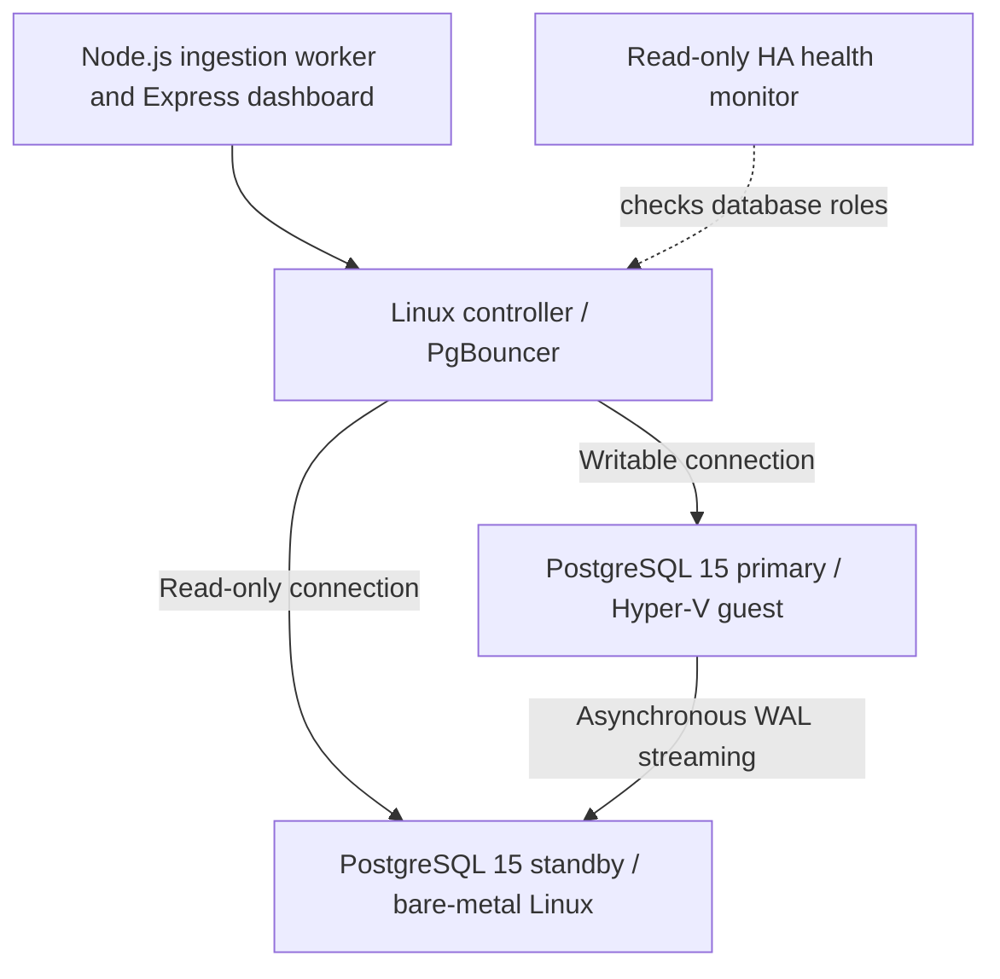

# Systems Engineering & DevOps | Hands-On Infrastructure Portfolio

**Linux administration • Infrastructure automation • PostgreSQL replication • Observability • Reliability engineering**

I build and troubleshoot systems in a self-directed, multi-node laboratory that combines bare-metal Linux hosts and Hyper-V virtual machines. My projects connect operating-system administration, networking, persistent storage, containers, databases, monitoring, and application services into end-to-end engineering exercises.

My documentation emphasizes **what I implemented, how I tested it, what failed, how I corrected it, and what remains unverified**. This is a learning and demonstration environment, not a commercial production deployment.

## Engineering skills

| Domain | Hands-on technologies and practices |
| --- | --- |
| Linux operations | Red Hat Enterprise Linux, Bash, SSH, systemd, users and permissions, SELinux, firewalld |
| Automation | Ansible, YAML, service configuration, repeatable operational runbooks |
| Containers and databases | Rootless Podman, PostgreSQL 15, persistent volumes, WAL streaming, PgBouncer |
| Applications | Node.js, Express, HTTP status endpoints, synthetic telemetry workloads |
| Storage and recovery | LVM, XFS, snapshots, mounting, NFS, recovery exercises |
| Networking and routing | Hyper-V networking, connection pools, HAProxy and NGINX experimentation |
| Observability | rsyslog, Prometheus, Grafana, Loki, Promtail, system and application logs |
| Reliability | Root-cause analysis, service health checks, role verification, failover risk assessment |

## Featured project: Multi-node PostgreSQL reliability and telemetry lab

**Goal:** Validate database replication, safe primary/standby routing, and application monitoring across heterogeneous hardware while investigating high-availability failure modes.

### Architecture

The final Phase 15 exercise used a Linux controller, a PostgreSQL primary inside a Hyper-V Linux virtual machine, and a physical Red Hat Linux standby. PgBouncer provided separate connection paths for the writable primary and read-only standby. Node.js and Express services generated and reported **simulated** telemetry, while a third systemd service monitored database roles without performing automatic failover.

### Results verified in November 2026

| Validation | Observed outcome |
| --- | --- |
| Database roles | Primary reported writable; standby reported recovery/read-only |
| WAL streaming | Replication state `streaming`, synchronization mode `async` |
| WAL progress | Sent/written/flushed/replayed positions matched on a primary-side snapshot; received and replayed positions matched on a standby-side snapshot |
| PgBouncer routing | Separate primary and standby listeners returned expected database roles |
| Service integration | Node.js application worker, Express dashboard, and HA monitor simultaneously reported `active` under systemd |
| Telemetry workload | **150 synthetic events in a five-minute window** confirmed by SQL |
| HA monitoring | Repeated healthy primary/standby role checks during an approximately five-minute observation |
| Failover policy testing | **11 of 11 synthetic cases passed** in a non-destructive Python decision simulator |

A primary-side query showed approximately **231 ms reported replay lag** in one snapshot. This is not a performance guarantee or a representative latency distribution.

### Engineering challenges and decisions

**Misrouted database traffic.** An incorrect connection-pool destination caused an application operation to reach a read-only PostgreSQL instance and fail with `cannot execute CREATE TABLE in a read-only transaction`. I inspected both connection paths and verified database roles before restoring the intended routing.

**DDL inside the event loop.** The telemetry service attempted `CREATE TABLE IF NOT EXISTS` during recurring ingestion. I separated schema setup from the steady-state insert path, reducing avoidable write failures on read-only connections.

**Unsafe failure escalation.** Earlier lab experiments used SSH-triggered host shutdown and promotion logic. I established that a connection or SQL error is **not** proof of physical host failure, disabled destructive automatic actions, and shifted the third service to monitoring-only operation.

**Failover decision safety.** I implemented a standalone Python simulator that rejects promotion when evidence is missing, such as independent fencing confirmation, a coordination lock, quorum/witness agreement, standby readiness, or acceptable WAL freshness. Even with every *synthetic* precondition satisfied, its final decision remains `REVIEW_ONLY` rather than an actual promotion.

### What was *not* validated

- Unattended PostgreSQL promotion and client rerouting after a real failure.
- Independently verified physical or Hyper-V fencing in all failure modes.
- A production-grade quorum or distributed coordination mechanism.
- Guaranteed zero data loss, recovery time objectives, or recovery point objectives.
- Automatic reintegration of the old primary after failover.

**Project closeout:** Phase 15 was completed for **replication, database routing, telemetry ingestion, and monitoring**. Automated failover remained disabled by design because the practice environment lacked independently validated fencing and coordination capabilities.

## Additional hands-on projects

### Linux infrastructure and configuration management

Built and maintained multi-node Linux lab systems; investigated systemd service failures, SSH access, permissions, time synchronization, networking, SELinux behavior, and firewall rules. Used Ansible playbooks and documented runbooks to make configuration tasks more repeatable.

### Storage administration, backup, and recovery

Practiced LVM and XFS administration, filesystem mounting, snapshot workflows, NFS access, and restore-oriented troubleshooting. Emphasized verifying storage state and recovery outcomes rather than assuming commands succeeded.

### Containerized database platform

Deployed PostgreSQL in rootless Podman, worked through persistent-data ownership and SELinux volume-label issues, established replication connectivity, and inspected container logs and PostgreSQL system views during fault diagnosis.

### Centralized logging and observability

Developed and investigated centralized log collection and metrics monitoring using rsyslog, Prometheus, Grafana, Loki, and related Linux tooling. Correlated application messages with systemd and database logs to investigate reliability problems.

### Web services and infrastructure integration

Built Node.js/Express operational endpoints and integrated the application with PostgreSQL through PgBouncer. Tested application status responses, query behavior, and ongoing simulated data ingestion during normal service operation.

## Engineering approach

1. **Build deliberately:** Document initial topology, dependencies, and assumptions.
2. **Verify with evidence:** Use service status, logs, SQL queries, and controlled tests.
3. **Investigate failures:** Separate database errors, routing errors, network faults, and host failures.
4. **Preserve safety:** Keep destructive actions disabled unless independent safeguards are verified.
5. **Document limitations:** Distinguish lab observations and simulations from production reliability claims.

## Laboratory screenshot evidence

The portfolio includes [**11 selected evidence screenshots with descriptions**](docs/10-visual-evidence.md), covering Phase 15 PostgreSQL replication, primary/standby routing, simulated telemetry, monitoring-only HA checks, synthetic failover-policy tests, Ansible deployment results, and Grafana dashboards. See [Phase 15 technical documentation](docs/13-phase15-replication-monitoring.md) and [the simulation case study](docs/14-phase15-failover-simulation.md) for the full discussion and limitations.

## Professional direction

I am developing deeper expertise in **systems engineering, Linux systems administration, infrastructure automation, database operations, observability, and reliability engineering**. The projects in this portfolio demonstrate practical problem-solving, troubleshooting discipline, and the ability to integrate multiple technologies into working systems.

---

**Evidence note:** This is a self-directed laboratory portfolio with selected, redacted screenshots of actual tests. Original source reports and unreviewed captures are not included. Simulated telemetry is not customer traffic, and no end-to-end automatic failover guarantee is claimed.
