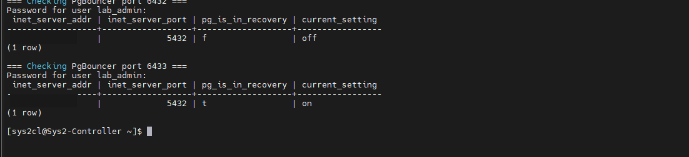
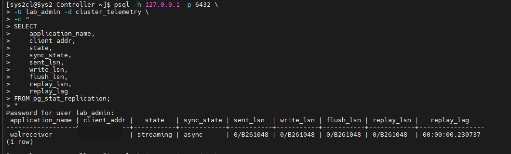
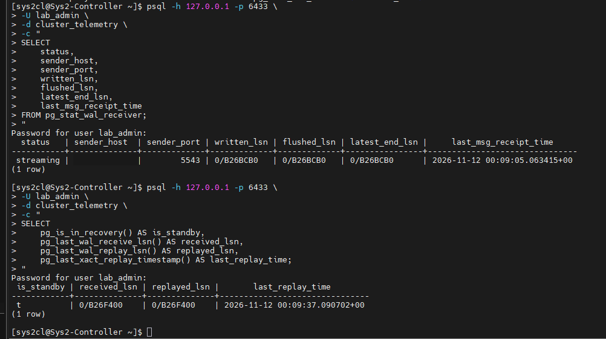
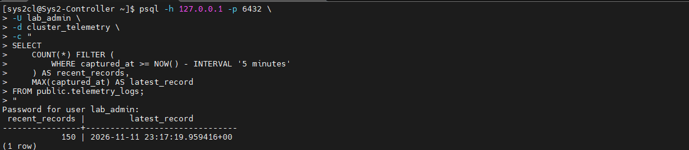
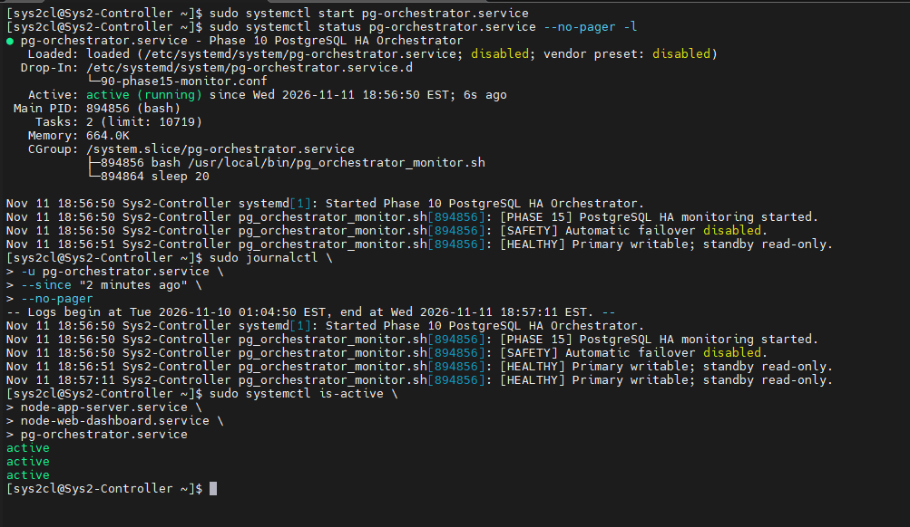
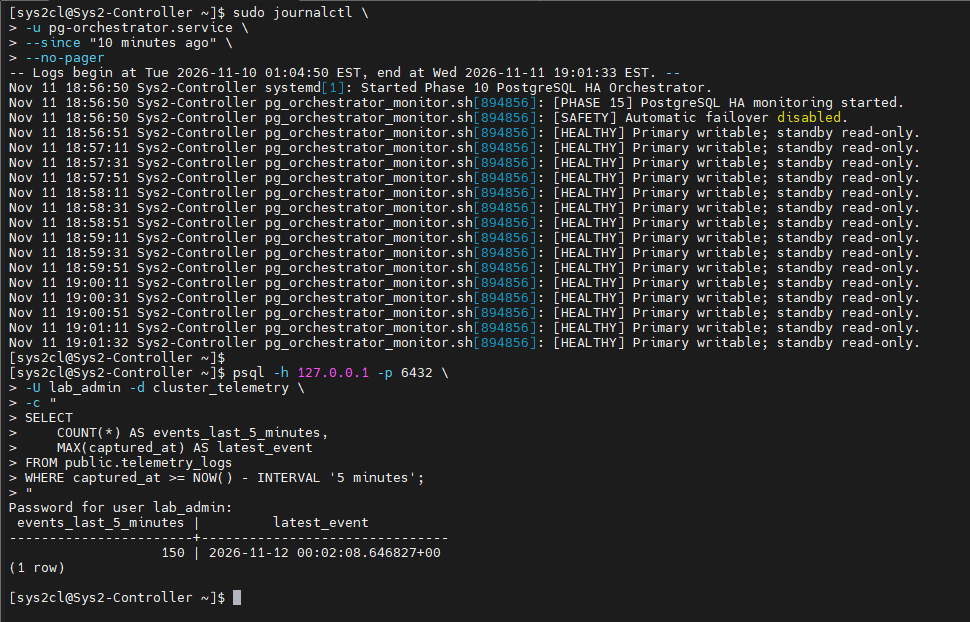
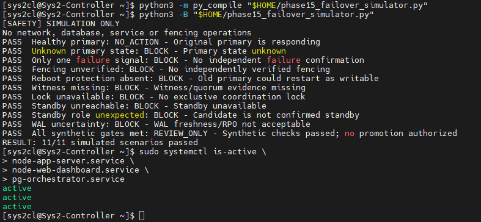
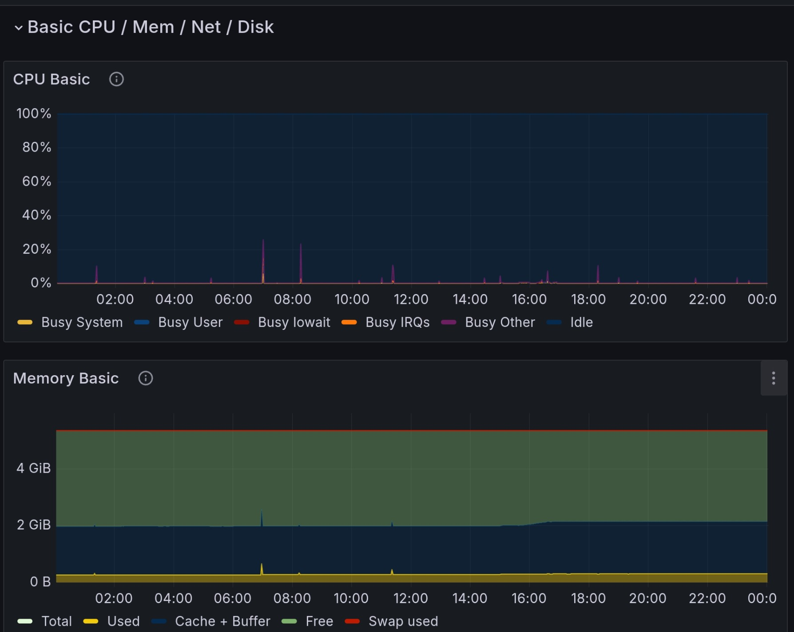
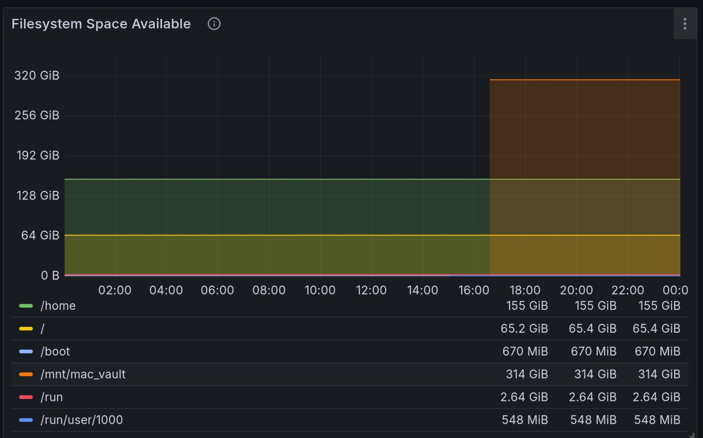

# Visual evidence — systems engineering laboratory

These are **selected, cropped or redacted screenshots of actual lab execution**, not reconstructed images or enterprise production workloads. Original unredacted captures and source reports remain private. Cropping and address masking remove identifying information without changing visible test results. Evidence is tied to the specific session in which it was captured.

## Phase 15 — PostgreSQL reliability and monitoring (November 2026)

### Correct PgBouncer routing and database roles

Direct database role queries through separate local PgBouncer listeners returned `pg_is_in_recovery() = false` and `transaction_read_only = off` for the **primary**, versus `true` and `on` for the **standby**. Private backend addresses have been masked. This shows correct roles at the time of the snapshot, not automatic failover.

### Primary PostgreSQL streaming replication

The `pg_stat_replication` query showed one WAL receiver in `streaming` state, with `sync_state = async`. Sent, written, flushed, and replayed LSNs matched in the captured snapshot. Reported replay lag was approximately 0.23 seconds **in this single snapshot only**. A private container address was masked.

### Standby WAL reception and replay

The standby's `pg_stat_wal_receiver` returned `streaming`, and follow-up SQL showed `pg_is_in_recovery()` true with received and replayed WAL positions matching. The sender's private network address is masked. Together with the primary-side query, this supports operational *asynchronous streaming replication*, not guaranteed zero data loss.

### Simulated telemetry ingestion

A SQL query reported **150 records** captured within a five-minute laboratory window. These are **simulated telemetry events**, not real commercial transaction data or a production load test.

### Monitoring-only orchestration and safety

The HA-monitor systemd unit was running under a monitor-only script; logs explicitly stated **automatic failover disabled**. In the same test, the application worker, dashboard, and monitor all reported `active`. The service name reflects historical project naming, not a validated automatic promotion capability.

A later `journalctl` window contained repeated `[HEALTHY] Primary writable; standby read-only` messages. The same screen included another successful query of 150 simulated telemetry events in five minutes. This is short-interval lab monitoring evidence, not an availability SLA.

### Non-destructive failover decision simulation

An isolated Python simulator reported **11/11 synthetic scenarios passed**, ending with `REVIEW_ONLY` when all hypothetical safety gates were satisfied. It did **not** perform host fencing, database promotion, client cutover, or any other destructive action. This tests policy branching, not end-to-end failover safety.

See [the Phase 15 case study](13-phase15-replication-monitoring.md) and [simulator methodology](14-phase15-failover-simulation.md) for context.

## Earlier automation and observability evidence (October 2026)

### Six-node Ansible telemetry deployment

Six completed host rows in an Ansible `PLAY RECAP` showed `unreachable=0` and `failed=0`. Host labels were masked. This demonstrates the recorded run's task results, not continuous endpoint health.

### Six-node firewall playbook

Six Linux nodes completed a firewall playbook with zero task failures. This does not independently verify all runtime policy semantics.

### Grafana CPU and memory visualization

Two Grafana panels show non-empty CPU and memory time-series data for selected targets in the captured observation interval. They do not demonstrate full-fleet continuous availability.

### Grafana filesystem metrics

A Grafana dashboard displayed storage capacity for several mounts, including a laboratory network-storage path. A metrics chart alone does not prove backups, restore success, or data integrity.

## What the evidence does not prove

The screenshots do **not** prove production-grade HA, independently verified fencing, guaranteed RPO/RTO, zero-downtime failover, automatic reintegration of an old primary, or successful recovery from every failure mode. All laboratory telemetry described as simulated remains simulated. Screenshots should be reviewed by the repository owner before changing visibility to Public.

[Return to the portfolio overview](../README.md)
