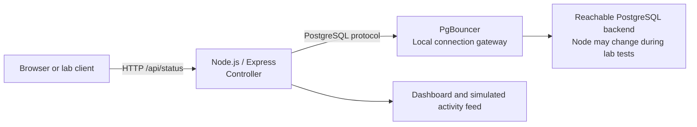

# Phase 12 — Application telemetry and PostgreSQL gateway integration

**Setting:** Self-directed systems engineering home lab | **Date:** November 2026  
**Scope:** Node.js/Express application, PgBouncer connection gateway, PostgreSQL role telemetry, operational troubleshooting, and a separately tested bare-metal reset mechanism.

> This case study documents a **lab application integration and failover investigation**, not a production-ready highly available service. The original source handover uses terms such as “production-grade” and “fully automated HA,” which are broader than the evidence supports.

## Objective and architecture

The objective was to give a lab client an HTTP endpoint through which it could observe the PostgreSQL backend and display activity in a browser. A Node.js/Express application on the controller connects through a local PgBouncer endpoint to a PostgreSQL instance managed on the lab network. In the captured session, a previously designated standby address was also observed serving as a writable primary after earlier promotion testing.

The diagram is conceptual and deliberately excludes detailed host mapping. The accompanying handover lists a primary at one address, while the November 6 application screenshots query a different address that reports `pg_is_in_recovery() = false`. Treat this as evidence of **different lab states over time**, not proof of a fixed final topology.

## What I implemented or tested

- Built an Express-based service with a `/api/status` JSON endpoint connected to PostgreSQL through PgBouncer.
- Observed an `ONLINE` JSON response with a database name and `is_replica: false` for the connected backend.
- Created a browser dashboard that refreshed its event feed; the displayed traffic includes **mock/simulated** request types, so it should not be described as real customer traffic.
- Verified `pgbouncer-primary.service` was active under systemd, with `SHOW POOLS` and `SHOW CLIENTS` results visible through its administrative console.
- Investigated Node dependency issues (`pg` module resolution), npm permissions, working-directory errors, runtime compatibility, and endpoint/port mismatches.
- Ran failover-orchestrator and remote reset experiments, collecting both successes and failures as diagnostic evidence.

## Evidence summary

My private laboratory evidence includes a working browser dashboard, a responsive status API, active PgBouncer administrative output, SQL replication queries, and failure logs from orchestration experiments. The evidence includes unsuccessful attempts and conflicting temporary database roles; I have not interpreted it as a successful unattended failover test.

*Unreviewed screenshots are intentionally excluded from the public repository.*

## Engineering post-mortem

**Port and routing alignment.** An early application request targeted the wrong backend directly. Repointing the application to the configured local pool endpoint allowed the expected database status query to succeed. This reinforced the need to distinguish client-to-proxy ports from proxy-to-database ports.

**Node runtime and project isolation.** The source notes show `Cannot find module 'pg'`, global npm permissions errors, and attempts to run project commands from the filesystem root. The working application was moved to an isolated user workspace with local dependencies and the correct execution directory.

**Failover state awareness.** The November 6 snapshots show a backend previously labeled as the standby answering as a primary, but the replication view contains no connected WAL sender sessions. In addition, the orchestrator log prints a successful-failover message even after a timed-out SSH promotion attempt. These are explicit validation gaps, not successful HA acceptance tests.

**Safe fencing design.** The handover describes a remote kernel SysRq-triggered immediate reboot. Such a reboot can cause filesystem/data loss because it bypasses disk synchronization and clean unmount. It is not included as a reusable or recommended fencing implementation. Production-like fencing requires deliberate safeguards, authoritative node state checks, prevention of dual-primary operation, operator-controlled failure injection, and recovery validation.

## Security and reproducibility

The handover embeds a plaintext password and shows a network-wide listen address and legacy MD5 authentication. None of those credentials or open-listener settings are published here as a reusable default. **Rotate any password that was used in the lab and appeared in source documents**, even if those source documents remain private. Use environment-based secret injection or a supported secret manager, restrict listeners and firewall sources, and use supported authentication appropriate to the deployment.

The source lists Node.js 18; this major release is past the Node.js project's end-of-life date. For any reproducible future demonstration, use a currently supported LTS release, test dependencies against it, and pin versions in `package-lock.json`.

A reconstructed, illustrative Phase 12 API example was created during the lab documentation process but is not included in this public update. It was not independently deployed or load-tested as a reusable application.

## Status at handover

**Verified:** functioning browser page, PgBouncer administrative access, a responsive database-status API, and a backend responding as primary.  
**Partial:** simulated app request loop, initial failover procedure diagnostics, and bare-metal reset experiment.  
**Not verified:** active replica at the time of the latest snapshot, protected unattended failover, data consistency after partition/failure, zero downtime, quantitative RTO/RPO, and secure production service exposure.

[Back to portfolio](../README.md)
