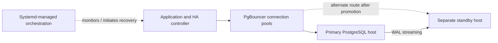

# Phase 14B — Cross-Hardware PostgreSQL High Availability and Recovery Validation

**Project type:** Self-directed systems engineering laboratory  
**Technology:** PostgreSQL 15 · rootless Podman · PgBouncer · Node.js · systemd · SSH · Linux  
**Date:** November 2026

## The engineering problem

A database outage should not require manually rebuilding the application connection path. I wanted to test whether a physically separate PostgreSQL standby could be promoted after loss of the primary, while preserving previously committed test data and restoring application queries through connection pooling.

## Laboratory architecture

The environment used three distinct Linux hosts: an **application/orchestration controller**, a **PostgreSQL primary**, and a **physically separate PostgreSQL standby**. PostgreSQL ran in rootless Podman containers; PgBouncer and systemd-managed Node.js services ran on the controller. The primary streamed WAL to the standby using asynchronous physical replication.

*The diagram summarizes the experiment and intentionally omits sensitive host addresses and credentials.*

## What I implemented and tested

1. Configured PostgreSQL physical replication between separate hardware hosts and checked WAL receiver/sender streaming status.
2. Configured the application to use PgBouncer connection pools for database access and tested database authentication and service recovery paths.
3. Updated the laboratory configuration to use SCRAM-SHA-256 authentication and restricted access to service credential files, as recorded in the engineering report.
4. Committed a timestamped test canary before a controlled primary-host shutdown and confirmed that the standby had replayed the required WAL position.
5. Observed outage detection, a fencing-check sequence, remote standby-promotion initiation, connection-pool switching, and subsequent application responses.
6. Queried the promoted database and inspected the canary records after the experiment.

## Results from the documented test

| Measurement | Recorded outcome | Interpretation |
| --- | --- | --- |
| Outage detection | 17:12:54.535 EST | Start of the measured application recovery interval |
| Failover routing initiated | 17:13:02.634 EST | Controller recorded the promotion/routing action |
| First successful application response | 17:13:06.365 EST | 11.83 s after outage detection |
| PostgreSQL recovery state after promotion | `pg_is_in_recovery() = false` | Consistent with a promoted, writable primary |
| Test data preservation | Pre-crash canary rows present | No loss observed for the validated sample records |

The timings and results are drawn from the laboratory's Phase 14B validation report. The experiment established **11.83 seconds from detected outage to successful application response**, not an end-to-end production availability guarantee.

## Troubleshooting decisions

- Corrected an undefined JavaScript promotion-function reference that previously crashed the orchestrator.
- Investigated PostgreSQL and PgBouncer authentication failures rather than treating every failed database login as a failed physical host.
- Adjusted connection-pool routing and service restart behavior and checked post-change service logs.
- Verified the PostgreSQL recovery role and preserved canary data after promotion.

## Limitations and next validation steps

- **Fencing confidence:** The controller's ICMP-based 'unpowered' message does not itself prove a host was physically powered off. A production-safe design needs independent fencing confirmation before permitting another writer.
- **Replication durability:** The lab used asynchronous WAL replication. Preservation of tested canary records does **not** establish a universal zero-data-loss RPO under every failure timing.
- **Write-path proof:** A repeatable application-level write/read transaction after promotion would strengthen the proof of restored read/write availability.
- **Repeatability:** The recorded 11.83-second figure is from a documented test. Additional trials under varied failure scenarios are needed before calculating a representative recovery-time distribution.
- **Rejoining the old primary:** The former primary must be reconciled against the promoted primary's timeline before it can safely return as a standby.

## Lessons learned

This project made the difference between *detecting a failure*, *safely deciding to fail over*, and *proving that data is still available* much clearer. I practiced tracing failures through the host, container, replication, connection-pool, and application layers and documenting what each test actually established.

**Evidence boundary:** This case study intentionally omits confidential configuration and raw captures.
