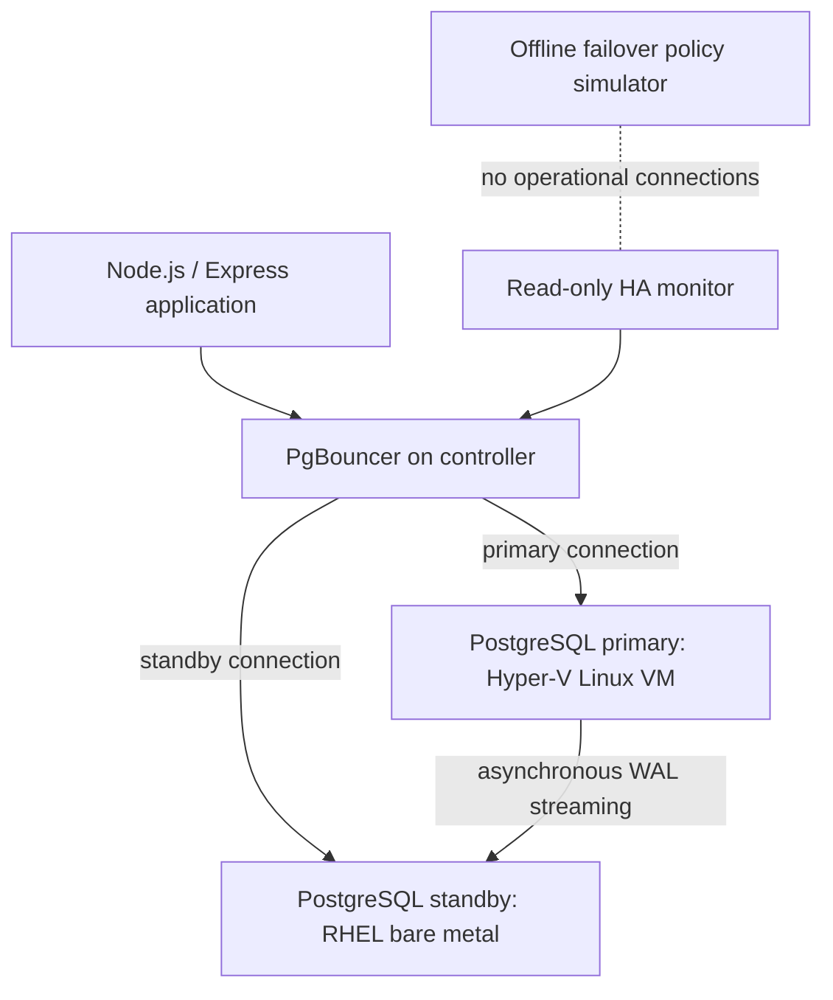

# Phase 15 — PostgreSQL Replication, Routing, Telemetry, and HA Monitoring

**Period:** November 2026  
**Environment:** Self-directed mixed bare-metal / virtual Linux laboratory  
**Technology:** PostgreSQL 15, rootless Podman, PgBouncer, Node.js, Express, systemd, Bash, Python

> **Final status:** Normal-operation replication, routing, ingestion, and monitoring validated. Automated fencing, unattended promotion, split-brain resilience, automatic failback, and production recovery guarantees **not validated**.

## Engineering objective

I wanted to operate an application-facing database gateway across different hardware environments, confirm that the standby continuously replayed WAL, and separate application telemetry failures from actual primary-node failures. The work extended earlier exercises in containerized PostgreSQL, connection pooling, and controlled recovery.

## Architecture at the final validation

- A Linux controller ran PgBouncer, a Node.js telemetry worker, an Express status/dashboard service, and a systemd monitoring process.
- The writable PostgreSQL primary ran in a Linux VM hosted on Windows Hyper-V.
- A physical HP EliteBook running Red Hat Linux held a PostgreSQL streaming standby.
- Two local PgBouncer listeners routed application connections to the writable primary and read-only standby, respectively.
- WAL replication was **asynchronous**, not synchronous or zero-loss guaranteed.

## Problems investigated and corrective decisions

### Incorrect connection-pool destination

During Phase 15 troubleshooting, a stale PgBouncer mapping sent an application's table-creation attempt to a read-only standby. PostgreSQL rejected the operation with `cannot execute CREATE TABLE in a read-only transaction`.

This application/route configuration error was mistakenly interpreted by earlier failover logic as a severe infrastructure fault, triggering repeated destructive-fencing attempts in the lab. I corrected the primary/standby routing and validated the two database roles independently. **Lesson:** query failure is not equivalent to physical host failure.

### DDL inside the ingestion request loop

The web worker repeatedly attempted `CREATE TABLE IF NOT EXISTS` during simulated telemetry ingestion. This was inappropriate for read-only connections and made operational errors harder to distinguish from expected replica behavior.

I moved the operation out of the recurring ingestion loop and used an existing telemetry table. Subsequent verification queries showed continuing inserts.

### Disabling unsafe automatic failover

The historical Node.js scripts included SSH-to-SysRq shutdown commands and a remote PostgreSQL promotion attempt. Although a shutdown experiment demonstrated an actual power-off, SSH cannot independently fence an unresponsive system.

I backed up the application source, checked JavaScript syntax, guarded historical destructive code behind an opt-in flag, and then kept the opt-in unset in systemd. The ingestion worker's failure path was changed to log warnings and require manual investigation instead of executing a hard reset.

The third service was changed from the older promotion script to a **monitoring-only** shell script. The service ran with restricted systemd privileges and repeatedly reported the expected primary/standby roles. These mitigations were verified in the captured lab session; they do not constitute a security review of every historical script.

## Final observed validation

| Check | Evidence observed | Assessment |
| --- | --- | --- |
| PgBouncer primary path | `pg_is_in_recovery() = false`; session read-only setting off | Correct writable role |
| PgBouncer standby path | `pg_is_in_recovery() = true`; session read-only setting on | Correct standby role |
| Primary WAL sender view | `state = streaming`, `sync_state = async` | Physical streaming active |
| Primary WAL positions | Sent, written, flushed, and replayed LSNs matched in one snapshot | No backlog visible in that snapshot |
| Standby WAL receiver | `status = streaming`, expected upstream sender | Receiver connected |
| Standby replay functions | Received and replayed LSNs matched in one snapshot | WAL replay caught up in that snapshot |
| Telemetry ingestion | 150 simulated records in a five-minute query | Ingestion active |
| Monitoring logs | Repeated `[HEALTHY] Primary writable; standby read-only` checks | Stable in observed interval |
| Services | Core worker, web dashboard, and HA monitor simultaneously `active` | systemd integration successful |
| Dry-run failover policy | 11/11 synthetic tests passed | Branch logic validated only |

One primary-side snapshot showed approximately 231 ms of reported replay lag. This is a **point-in-time observation**, not a guaranteed replication-latency metric.

The monitoring-only service displayed healthy results over approximately five minutes. The latest record and timestamps confirmed continued simulated activity. No live primary-host outage was executed during this closeout stage.

## Non-destructive decision simulator

An isolated Python simulator was built to reject promotion when important evidence was absent: unknown primary state, lack of independent failure confirmation, missing fencing, reboot exposure, missing witness/lock, unavailable standby, unexpected role, or unacceptable WAL freshness.

It passed 11 of 11 synthetic scenarios and deliberately ended with `REVIEW_ONLY` even if all synthetic gates were satisfied. See [Phase 15 failover simulation](14-phase15-failover-simulation.md) and the [Python example](../examples/failover_policy_simulator.py).

## Hardware and fencing feasibility

The final lab used an HP EliteBook as the bare-metal standby and a separate Dell Windows/Hyper-V host for the primary VM. The Dell host's administrator PowerShell could enumerate and identify the PostgreSQL VM. A Linux Management Engine device was present on the HP laptop, but usable out-of-band fencing support was **not established**.

The earlier SSH SysRq experiment was not considered an independent hardware-fencing mechanism. No Windows Hyper-V VM power-off was executed as part of the final validation, and no verified quorum/leader-lock service was implemented.

Because of these gaps, I **chose not to enable unattended failover**. This was a deliberate safety decision appropriate to the laboratory's available infrastructure.

## Outcome and boundaries

**Validated in the lab:** asynchronous streaming replication, primary/standby role discrimination, WAL replay observation, differentiated PgBouncer routing, application telemetry ingestion, systemd-managed services, read-only health monitoring, and deterministic simulated failover-policy checks.

**Not demonstrated:** safe unattended promotion following arbitrary network/host failures, independent authoritative fencing in every failure mode, prevention of all split-brain scenarios, guaranteed zero data loss, tested automatic rejoin/failback, representative RTO/RPO distributions, or production readiness.

## Lessons learned

- Confirm routing endpoints and `pg_is_in_recovery()` before classifying a connection failure.
- Keep schema migrations separate from high-frequency application write paths.
- Use verification from both WAL sender and receiver, not just table-existence checks.
- Distinguish monitoring, failure detection, fencing, promotion, and recovery as separate engineering responsibilities.
- Protect working systems by keeping destructive code inactive until independent fencing and coordination have been designed and tested.

*Private source reports, screenshots, host identifiers, credentials, and unreviewed logs have not been published with this case study.*

[Back to portfolio](../README.md)
